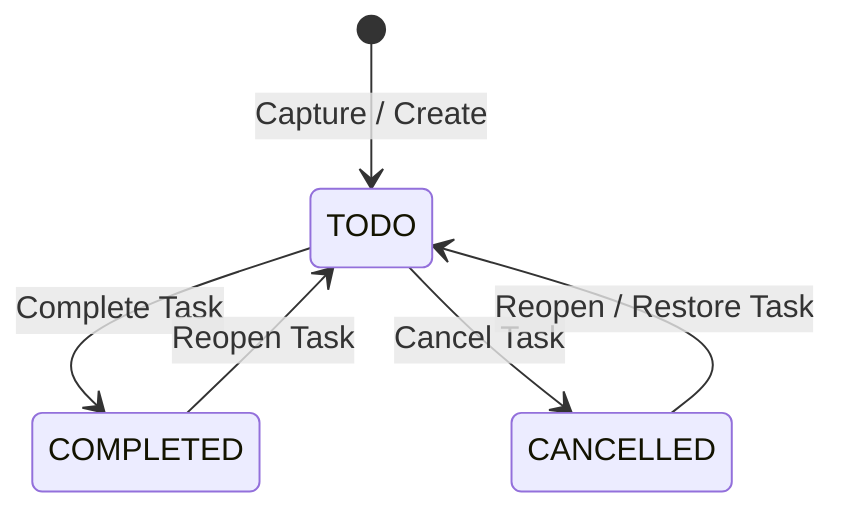

# Task Feature

## Purpose

The Task is the fundamental atomic unit of execution in TrackUp. While Goals define *where* the user wants to go and Projects define *what initiatives* will take them there, Tasks represent the *concrete actions* the user takes on a daily basis.

TrackUp's core product loop is:

$$\text{Capture} \longrightarrow \text{Plan} \longrightarrow \text{Execute} \longrightarrow \text{Track} \longrightarrow \text{Review} \longrightarrow \text{Improve}$$

The Task domain serves this loop at every phase:
- **Capture:** Provides low-friction entry of actionable commitments without forcing premature categorization.
- **Plan:** Enables the user to schedule what to do today and prioritize commitments against their cognitive capacity.
- **Execute:** Gives the user a focused, unambiguous checklist of actions to perform without distraction.
- **Track & Review:** Records completed work, completion timestamps, and operational throughput to provide honest data for reflection and continuous improvement.

---

## Task Definition

A **Task** is a single, actionable commitment that can be completed by one person in a discrete period of time.

Key domain characteristics of a Task:
- **Atomic:** It represents a self-contained action (e.g., "Draft project proposal", "Call plumber"), not a vague aspirational outcome or a multi-week initiative.
- **Action-oriented:** It starts with or implies a verb; it is either pending completion or completed.
- **Autonomous yet Context-Aware:** A task can exist entirely independently as a standalone action, or it can belong to a Project to advance a larger initiative.
- **Personal:** TrackUp is a personal Life Operating System; every task is strictly owned and managed by a single user.

---

## Task Properties

### Selected MVP Properties

| Property | Data Type | Requirement | Description | Why Necessary for MVP |
| :--- | :--- | :--- | :--- | :--- |
| `id` | Identifier | Required (Server-generated) | Immutable, server-generated unique identifier for the task. | Required for primary key identity, entity references across API endpoints, deterministic client caching, and relationship mapping. (Exact storage format is deferred to database schema design). |
| `userId` | Identifier | Required | Identifier of the user who owns the task. | TrackUp is a multi-tenant personal system. Strict ownership is required for data isolation, security, and user-scoped queries. |
| `projectId` | Identifier | Optional (Nullable) | Identifier of the project this task belongs to. | Supports Product Decision 1: A task can exist without a project. Allows grouping tasks into initiatives without forcing overhead on standalone chores. |
| `title` | String | Required | Concise, one-line summary of the action to be taken. | The core visible element in lists and daily views. A task cannot exist without a description of what must be done. |
| `description` | String / Text | Optional (Nullable) | Unstructured supporting text, notes, context, or links. | Keeps quick capture fast and lightweight while allowing complex tasks to retain necessary context without bloating the title. Must not represent structured subtasks. |
| `status` | Enum | Required | Current state in the task lifecycle (`TODO`, `COMPLETED`, `CANCELLED`). | Defines whether the action is pending, finished, or abandoned. Essential for filtering active work and calculating completion metrics. |
| `priority` | Enum | Required (Default: `MEDIUM`) | Level of urgency/importance (`LOW`, `MEDIUM`, `HIGH`). | Essential for the "Plan" and "Execute" phases. In the Today/Dashboard view, users need clear signals on what to do first. |
| `dueDate` | Date (Calendar Date) | Optional (Nullable) | Target calendar date by which the task should be performed (`YYYY-MM-DD`). | Powers the "Today", "Upcoming", and overdue planning views. Distinguishes scheduled commitments from backlog items. |
| `completedAt` | Timestamp (UTC) | Optional (Nullable) | Timestamp of the task's most recent transition into `COMPLETED`. | Essential for "Track" and "Review" phases: powers completion streaks, daily productivity summaries, and historical logs. Cleared if reopened. |
| `createdAt` | Timestamp (UTC) | Required | Timestamp when the task was initially created. | Auditability, ordering inbox tasks chronologically, and tracking task age (how long a task has been lingering). |
| `updatedAt` | Timestamp (UTC) | Required | Timestamp when the task was last modified. | Concurrency management, change tracking, and syncing local state. |

---

### Detailed Property Justification & Semantics

#### 1. Identifier Strategy (`id`)
- **Decision:** `id` is an immutable, server-generated unique identifier.
- **Reasoning:** The domain requires an unambiguous handle for entity resolution, authorization checks, and API endpoints. The exact underlying format (e.g., UUIDv4, UUIDv7, CUID2) is an implementation detail that will be finalized during database architecture and schema design. The domain contract guarantees only that it is unique, server-assigned, immutable, and URL-safe.

#### 2. Due Date Semantics & Past Due Dates
- **Decision:** `dueDate` is stored as an absolute **Calendar Date (`YYYY-MM-DD`)** without a time-of-day component. Past due dates are explicitly permitted.
- **Reasoning:**
  - *Calendar Date vs Timestamp:* Personal commitments belong to a calendar day, not a minute-level calendar slot. Time-level granularity causes false precision and painful timezone-shift anomalies when traveling.
  - *Past Due Dates Allowed:* Users must be able to capture tasks that are already overdue or log commitments retroactively. Rejecting past dates breaks natural capture.
  - *Overdue as a Derived Condition:* Overdue is **not** a distinct lifecycle state. A task is considered overdue if:
    $$\text{status} \neq \text{COMPLETED} \quad \land \quad \text{dueDate} < \text{today}$$
    where $\text{today}$ is the current calendar date in the user's local timezone. Overdue is derived at query/presentation time, not persisted as a database state.

#### 3. Description Semantics: Unstructured Context Only
- **Decision:** `description` is strictly unstructured supporting text (plain text or basic Markdown notes).
- **Reasoning:** `description` must **not** be treated as a structured checklist or a container for pseudo-subtasks. Allowing checklist semantics inside a freeform description creates ambiguous completion states (e.g., "is a task complete if 2 of 3 markdown checkboxes are checked?"). Subtasks and structured checklists are explicitly out of scope for the MVP.

#### 4. Priority Decision: Why Three Levels (and No `CRITICAL`)
- **Decision:** Priority is restricted to three levels: `LOW`, `MEDIUM`, `HIGH` (defaulting to `MEDIUM`).
- **Reasoning:**
  - Three tiers provide sufficient granularity for personal daily planning (Today / Dashboard).
  - Introducing a fourth tier like `CRITICAL` (or P0) becomes an overused emergency label that induces chronic urgency without clarifying operational action.
  - TrackUp minimizes cognitive friction during capture and planning. Truly urgent work is cleanly modeled by combining `HIGH` priority with a near or immediate `dueDate`.

#### 5. Project Relationship (`projectId`)
- **Decision:** `projectId` is optional (nullable).
- **Reasoning:** Enforces Product Decision 1. Personal lives have numerous operational tasks that do not justify an entire project (e.g., "Change air filters", "Renew vehicle registration"). Forcing every task into a project leads to artificial container fatigue (e.g., creating dummy projects like "Miscellaneous" or "Chores").

#### 6. Ownership (`userId`)
- **Decision:** `userId` is immutable and required on every task record.
- **Reasoning:** TrackUp is a private, personal operating system. Every query, mutation, and validation check must be strictly scoped to the authenticated `userId`.

#### 7. Completion Timestamp Semantics (`completedAt`)
- **Decision:** `completedAt` records the timestamp of the task's **most recent transition** into `COMPLETED`.
- **Reasoning:**
  - `completedAt` provides accurate data for daily execution reviews, streaks, and completion velocity.
  - It is **not** a comprehensive historical completion audit log. If a task transitions:
    $$\text{TODO} \longrightarrow \text{COMPLETED (Oct 1)} \longrightarrow \text{TODO} \longrightarrow \text{COMPLETED (Oct 5)}$$
    the final `completedAt` is recorded as October 5.
  - When a task leaves `COMPLETED` (reopened to `TODO` or permanently deleted), `completedAt` is reset to `null`.
  - Full event sourcing and task history auditing are intentionally excluded from MVP scope.

---

### Evaluated and Intentionally Excluded Properties

| Property | Status | Rationale for Exclusion from MVP |
| :--- | :--- | :--- |
| `goalId` (Direct Relationship) | Excluded | See the dedicated [Goal Relationship Evaluation](#goal-relationship-evaluation) below. Adding direct `goalId` creates cognitive capture friction and dual-source ambiguity. |
| `CRITICAL` Priority Level | Excluded | Leads to priority inflation and anxiety. Three distinct tiers (`LOW`, `MEDIUM`, `HIGH`) combined with dates provide clear, sufficient daily planning signals. |
| `subtasks` / `parentTaskId` / Checklists | Excluded | Introduces recursive hierarchy, nested state resolution, and complex UI nesting. In MVP, multi-step endeavors belong in a `Project`. |
| `recurringRule` / Recurrence | Excluded | Recurring schedules require automated background worker jobs, edge-case handling for skipped occurrences, and complex generation logic. Handled in a future habit/routine milestone. |
| `tags` / `labels` | Excluded | Introduces a secondary taxonomy dimension that competes with Projects. Users spend more time organizing tags than executing tasks. |
| `estimatedDuration` / `timeSpent` | Excluded | TrackUp MVP prioritizes binary daily execution and throughput. Fine-grained time tracking introduces friction during both capture and execution. |
| `reminderAt` / Push Notifications | Excluded | Requires background schedulers, push notification infrastructure, and device permission handling. MVP relies on the intentional morning/evening "Plan" review habit on the Dashboard. |
| `orderIndex` / Manual Drag-and-Drop Rank | Excluded | Arbitrary manual reordering across lists requires complex fractional indexing (e.g., LexoRank) and creates sync conflict complexity. In MVP, deterministic sorting by `dueDate`, `priority`, and `createdAt` is superior and predictable. |
| `assigneeId` / Collaborators | Excluded | TrackUp is strictly a personal Life Operating System. Multi-user assignment is out of domain. |

---

### Goal Relationship Evaluation

An important architectural question is whether a Task should have a direct foreign key to a Goal (`goalId`).

#### Evaluated Architectural Models

**Model A: Hierarchical Pipeline**
```text
Goal (Outcome)
  └── Project (Initiative)
        └── Task (Action)
```
- Standalone tasks have no Project and no Goal.
- Project tasks contribute to a Project, which in turn contributes to a Goal.

**Model B: Dual Direct Association**
```text
Goal ─────────────┐
  │               ▼
  └──→ Project ──→ Task
```
- A task can link directly to a Goal, or to a Project, or to both.

#### Evaluation Against TrackUp Principles

1. **Capture Friction:** TrackUp's core philosophy requires effortless capture. If a user is asked to categorize a quick task into both a Goal and a Project, capture velocity is ruined.
2. **Mental Model Integrity:** A Goal represents a high-level outcome or desired future state (e.g., "Reach 15% body fat", "Publish tech book"). Goals do not get checked off in 15 minutes; they require projects/milestones. Direct ad-hoc tasks linked to goals blur the boundary between strategic goals and operational projects.
3. **Data Integrity & Dual Source of Truth:** If Task $T$ has `projectId = P1` (which links to `goalId = G1`), but the user directly sets `T.goalId = G2`, the system has an irreconcilable conflict. Which goal does the task actually advance? Resolving such conflicts requires complicated validation and sync logic.
4. **Standalone Tasks are Operational:** Tasks without projects are operational maintenance (e.g., "Pick up dry cleaning"). They are not strategic goals. Giving them a `goalId` makes no domain sense.

#### MVP Decision
**Model A is adopted. Tasks will NOT have a direct `goalId` in MVP.**
- A Task optionally links to a `Project`.
- A Project optionally links to a `Goal`.
- A Task advances a Goal *through* its parent Project.
- Standalone tasks remain independent operational actions.
- No `goalId` field will be added to the Task entity in MVP.

---

## Task Lifecycle

### Evaluation of Common States & Transitions

Many task systems mindlessly copy Kanban or bug-tracking states without considering personal productivity:
- `IN_PROGRESS`: In team issue trackers (Jira, GitHub Issues), `IN_PROGRESS` communicates state to teammates ("Someone is currently working on this, do not duplicate work"). In a single-user Life OS, `IN_PROGRESS` is an anti-pattern: users mark 15 tasks "in progress", where they sit untouched for weeks, creating cognitive clutter and guilt. Active daily focus is handled by scheduling work for "Today", not by an artificial stagnant state.
- `CANCELLED`: In life, dropping a task intentionally is a valid and healthy choice. Deleting an abandoned task destroys historical truth and makes retrospective review impossible. Leaving it as `TODO` clutters the system. `CANCELLED` preserves historical reality without counting against completion rates.
- `COMPLETED → CANCELLED` is **excluded**: A completed task represents a commitment that was fulfilled. A cancelled task represents a commitment that was intentionally abandoned. These states are semantically mutually exclusive. If a task was marked completed by mistake, it must be reopened to `TODO` first. It cannot transition directly from `COMPLETED` to `CANCELLED`.
- **Task Deletion is an Operation, Not a State:** Deleting a task permanently purges the record (hard delete). It is an administrative action to erase mistakes, not a lifecycle state.

### Selected MVP States

TrackUp defines exactly three lifecycle states:



#### 1. `TODO`
- **Definition:** The task is active, pending execution, and waiting to be planned or executed.
- **Entry:** When a task is initially created/captured, or when a completed or cancelled task is reopened.
- **Exit:** When the user marks it completed, cancels it, or permanently deletes it.
- **Timestamp State:** `completedAt` must be `null`.

#### 2. `COMPLETED`
- **Definition:** The commitment has been satisfied. The action is done.
- **Entry:** The user marks an active `TODO` task as completed.
- **Exit:** The user reopens the task (returning to `TODO`) or permanently deletes it.
- **Timestamp State:** `completedAt` must be set to the current UTC timestamp (`now()`).

#### 3. `CANCELLED`
- **Definition:** The commitment was evaluated during planning or review and intentionally abandoned or deemed no longer relevant.
- **Entry:** The user explicitly cancels an active `TODO` task.
- **Exit:** The user reopens the task (returning to `TODO`) or permanently deletes it.
- **Timestamp State:** `completedAt` must be `null`.

### State Transition Matrix

| Current State | Target State | Trigger / User Action | Required System Side Effects |
| :--- | :--- | :--- | :--- |
| *(None)* | `TODO` | Create task | Set `createdAt = now()`, `updatedAt = now()`, `completedAt = null`. |
| `TODO` | `COMPLETED` | Mark Complete | Set `status = COMPLETED`, `completedAt = now()`, `updatedAt = now()`. |
| `COMPLETED` | `TODO` | Reopen / Uncomplete | Set `status = TODO`, `completedAt = null`, `updatedAt = now()`. |
| `TODO` | `CANCELLED` | Cancel Task | Set `status = CANCELLED`, `completedAt = null`, `updatedAt = now()`. |
| `CANCELLED` | `TODO` | Reopen / Restore | Set `status = TODO`, `completedAt = null`, `updatedAt = now()`. |
| *Any State* | *(Purged)* | Delete Task | Irreversible hard delete: row is permanently removed from the database. |

---

## User Actions

The Task feature supports the following atomic user actions:

### 1. Capture Task (Quick Create)
- The user enters a task with minimal required friction.
- Only `title` is required at creation.
- Optional fields (`description`, `priority`, `dueDate`, `projectId`) can be supplied immediately or deferred to the Plan phase.
- Newly captured tasks default to `status: TODO` and `priority: MEDIUM`.

### 2. View Tasks
The user queries their tasks across different views:
- **Today View:** Tasks where `dueDate` equals the user's current calendar date AND `status != CANCELLED`.
- **Inbox View:** A conceptual view representing newly captured work that has not yet been planned (no `dueDate`) or organized into a Project (`projectId IS NULL`), with `status == TODO`. (See [Inbox Semantics](#6-inbox-semantics) below).
- **Project View:** Tasks filtered by a specific `projectId`.
- **Completed View / History:** Tasks with `status == COMPLETED`, ordered by `completedAt DESC`.

### 3. Update Task Details
- The user can update any of: `title`, `description`, `priority`, `dueDate`, or `projectId`.
- Updating a task automatically touches `updatedAt`.
- A task can be reassigned to a different project or detached from its project (setting `projectId = null`).

### 4. Complete Task
- The user marks an active `TODO` task as done.
- Sets `status = COMPLETED` and records `completedAt = now()`.

### 5. Reopen Task
- The user reopens a completed or cancelled task.
- Sets `status = TODO` and clears `completedAt = null`.

### 6. Cancel Task
- The user explicitly abandons an active `TODO` task.
- Sets `status = CANCELLED` and clears `completedAt = null`.

### 7. Delete Task
- The user permanently removes a task that was created in error.
- Irreversible **hard delete** operation that completely purges the task record from the database.

---

## Business Rules

### 1. Multi-Tenant Isolation and Ownership
- A user can **only** read, create, update, or delete tasks where `task.userId == authenticatedUserId`.
- A user cannot transfer ownership of a task to another user (`userId` is immutable).
- Cross-user data leakage in any query or mutation is strictly forbidden.

### 2. Project Association Integrity
- If `projectId` is provided, the referenced Project **must exist and must belong to the same `userId`**.
- Attempting to attach a task to a project owned by a different user must be rejected with an authorization or not found error.
- A task can be detached from a project at any time by setting `projectId = null`.

### 3. Project Deletion Behavior (Orphan Prevention)
- When a Project is deleted, the system **must not** delete associated tasks if the user intended to preserve the action items.
- **Rule:** Project deletion cascades a foreign key nullification (`ON DELETE SET NULL`) on `tasks.projectId`. Tasks belonging to the deleted project revert to standalone tasks in the user's backlog, preserving execution history and completed records.

### 4. Completion Timestamp Consistency
- Whenever `status` transitions to `COMPLETED`, `completedAt` **must** be populated with the current UTC timestamp by the server.
- Whenever `status` transitions away from `COMPLETED` (e.g., reopened to `TODO`), `completedAt` **must** be reset to `null`.
- Manual client overrides of `completedAt` are rejected; the server controls the completion timestamp.
- Detailed completion event history (audit logs of prior completions) is outside MVP scope.

### 5. Date-Only Due Date & Overdue Derivation
- `dueDate` represents an absolute calendar day (`YYYY-MM-DD`).
- Past due dates are valid on task creation and update.
- Overdue is a derived runtime condition (`status != COMPLETED AND dueDate < today`), evaluated using the user's local calendar day.
- Overdue is **never** stored or persisted as a database lifecycle status.

### 6. Inbox Semantics
- **Conceptual Definition:** The Inbox represents captured work that has not yet been scheduled into a timeframe or organized into a Project container.
- The database filter (`projectId IS NULL AND dueDate IS NULL AND status = TODO`) is an implementation representation of this concept.
- There is no separate `Inbox` table, flag, or database entity.

### 7. Task Deletion Policy (Hard Delete)
- For the MVP, task deletion is strictly a **hard delete**.
- When a task is deleted, its record is permanently purged from the database.
- Soft deletion (e.g., `deletedAt`, archive flags, or recycle bins) is intentionally excluded from the MVP. Abandoned work is preserved using `CANCELLED`; deletion is reserved for erroneous entries.

---

## Validation Rules

| Field | Validation Constraint | Error Condition / Response |
| :--- | :--- | :--- |
| `id` | Must be a valid, non-empty identifier string matching the server's ID strategy. | Reject if malformed or empty. (Generated server-side on creation). |
| `userId` | Must be a valid identifier corresponding to the authenticated session. | Server-derived. Client-provided overrides ignored or rejected. |
| `title` | - Type: String<br>- Must be trimmed of leading/trailing whitespace<br>- Minimum length: 1 character<br>- Maximum length: 255 characters | Reject with `400 Bad Request` if empty, whitespace-only, or $> 255$ characters. |
| `description` | - Type: String or Null<br>- Unstructured text / basic Markdown<br>- Maximum length: 5,000 characters | Reject with `400 Bad Request` if $> 5,000$ characters. Null or empty string stored as `null`. |
| `status` | Must be one of the enum values: `['TODO', 'COMPLETED', 'CANCELLED']`. | Reject with `400 Bad Request` if not in enum list. Default: `TODO`. |
| `priority` | Must be one of the enum values: `['LOW', 'MEDIUM', 'HIGH']`. | Reject with `400 Bad Request` if not in enum list. Default: `MEDIUM`. |
| `dueDate` | - Must be a valid ISO 8601 calendar date string (`YYYY-MM-DD`) or `null`.<br>- Past dates are permitted. | Reject with `400 Bad Request` if format is invalid or represents an impossible calendar day (e.g., `2026-02-30`). |
| `projectId` | - Must be a valid identifier or `null`.<br>- If present, must exist in `projects` table and match current `userId`. | Reject with `404 Not Found` if project does not exist or belongs to another user. |
| `completedAt` | Managed exclusively by server lifecycle transitions. | Reject or ignore any client attempt to manually inject an arbitrary timestamp. |

---

## Edge Cases

### 1. Empty or Whitespace-Only Title
- **Scenario:** The user submits a task creation or title update with an empty string or only whitespace characters (e.g., `"   "`).
- **Expected Behavior:** The request is rejected before any database operation occurs; no record is created or modified.
- **Handling / Enforcement Layer:** Input validation layer (Zod schema in API handler). Returns `400 Bad Request` with an explicit message: `"Title is required and cannot be empty"`.

### 2. Title or Description Exceeding Maximum Length
- **Scenario:** The user pastes a massive block of text into `title` (> 255 chars) or `description` (> 5,000 chars).
- **Expected Behavior:** Request is rejected with a clear validation error indicating the exceeded boundary.
- **Handling / Enforcement Layer:** Input validation layer (Zod). Rejects with `400 Bad Request` before invoking database queries.

### 3. Creating or Updating Task with a Past Due Date
- **Scenario:** The user creates a task with a `dueDate` of yesterday or last week, or edits an existing task to a past date.
- **Expected Behavior:** The task is accepted and saved successfully. If `status == TODO`, the task is immediately evaluated as overdue in planning queries.
- **Handling / Enforcement Layer:** Input validation permits any valid calendar date string. The presentation/query layer derives overdue status based on `dueDate < today`.

### 4. Invalid Calendar Date Format or Impossible Date
- **Scenario:** Client sends a malformed date string (e.g., `"tomorrow"`, `"10-04-2026"`, or `"2026-02-30"`).
- **Expected Behavior:** The request is rejected with a format validation error.
- **Handling / Enforcement Layer:** Input validation layer (Zod regex `^\d{4}-\d{2}-\d{2}$` verified with a strict calendar date validator). Returns `400 Bad Request`.

### 5. Malformed or Non-Existent Task Identifier (Invalid ID)
- **Scenario:** A client requests an endpoint using an invalid ID format (e.g., `/api/tasks/abc-123-not-valid`) or a properly formatted ID that does not exist in the database.
- **Expected Behavior:** System cleanly rejects malformed identifiers, or reports that the resource was not found.
- **Handling / Enforcement Layer:** Route parameter validation rejects malformed formats with `400 Bad Request`. Database query returning 0 records results in `404 Not Found`.

### 6. Unauthenticated Request or Expired Session Token
- **Scenario:** A user attempts to create, read, or modify tasks after their session token has expired or without providing authentication credentials.
- **Expected Behavior:** The request is immediately rejected without inspecting task data or executing business logic.
- **Handling / Enforcement Layer:** Authentication middleware (Fastify hook / pre-handler). Returns `401 Unauthorized`.

### 7. Cross-Tenant Ownership Violation
- **Scenario:** An authenticated User A attempts to read, update, or delete a task belonging to User B by guessing or obtaining User B's task ID.
- **Expected Behavior:** The system acts as if the record does not exist. No data is revealed, modified, or deleted.
- **Handling / Enforcement Layer:** Authorization / Data Access layer. Every query enforces `WHERE id = :taskId AND user_id = :authenticatedUserId`. If 0 rows match, returns `404 Not Found` (preventing ID enumeration).

### 8. Assigning Task to a Foreign or Deleted Project
- **Scenario:** The user sends a request to set `projectId` to a project owned by a different user or to a project ID that has already been deleted.
- **Expected Behavior:** The association is prevented. The task is neither created nor reassigned.
- **Handling / Enforcement Layer:** Business logic / Service layer verifies project existence scoped to the authenticated user (`SELECT 1 FROM projects WHERE id = :projectId AND user_id = :userId`). Returns `404 Not Found` if invalid.

### 9. Parent Project Deleted While Task Operations are In-Flight
- **Scenario:** A user deletes a Project in one browser tab while completing or updating a task belonging to that project in another tab.
- **Expected Behavior:** The task operation succeeds. If the project was deleted prior to or during the task update, the foreign key nullification (`ON DELETE SET NULL`) detaches the task cleanly without database foreign key violation errors.
- **Handling / Enforcement Layer:** Database foreign key constraint (`ON DELETE SET NULL`) combined with transaction isolation in the service layer.

### 10. Rapid Duplicate / Idempotent Lifecycle Requests
- **Scenario:** The user rapidly double-clicks "Complete" or network retries resubmit a completion request for an already `COMPLETED` task.
- **Expected Behavior:** The operation is idempotent. The task remains `COMPLETED`, the original `completedAt` timestamp is preserved (not overwritten), and the server returns `200 OK`.
- **Handling / Enforcement Layer:** Service / Business logic layer checks existing state before applying side effects: if already `COMPLETED`, return current record without touching `completedAt`.

### 11. Invalid Lifecycle State Transition Attempt
- **Scenario:** A client sends a direct request to transition a task from `COMPLETED` directly to `CANCELLED`.
- **Expected Behavior:** The request is rejected as an invalid state transition.
- **Handling / Enforcement Layer:** Business logic / Domain service layer validates state transitions against the permitted transition matrix. Returns `400 Bad Request` with message: `"Invalid state transition from COMPLETED to CANCELLED. Reopen the task first."`

### 12. Concurrent / Stale Task Modifications
- **Scenario:** The user has TrackUp open in two tabs. Tab A edits the task title. Tab B (which has not refreshed) updates the task description.
- **Expected Behavior:** The latest write wins at the field level, or an update conflict is avoided by timestamp tracking; `updatedAt` is updated to the latest modification time.
- **Handling / Enforcement Layer:** Service layer updates `updatedAt = now()`. (Optimistic concurrency locking via version/`updatedAt` can be evaluated if strict collision rejection is required in later phases).

### 13. Large Task Collections / Performance on Virtual Views
- **Scenario:** A power user has accumulated thousands of completed tasks over many months and queries their dashboard or task list.
- **Expected Behavior:** Virtual views (Today, Inbox) load instantly without scanning thousands of historical completed records.
- **Handling / Enforcement Layer:** Database indexing strategy: Composite indexes on `(user_id, status, due_date)` and `(user_id, project_id, status)` ensure queries filter out completed/cancelled records efficiently.

---

## MVP Scope

The Task feature for TrackUp MVP includes only the essential capabilities required to support the core loop:

1. **Quick Capture:** Fast task creation requiring only a `title`.
2. **Core Attributes:** Support for `title`, `description`, `priority` (`LOW`, `MEDIUM`, `HIGH`), and `dueDate` (`YYYY-MM-DD`).
3. **Optional Project Grouping:** Assigning a task to an existing user project or keeping it standalone.
4. **Lifecycle Management:** Complete state transition support for `TODO`, `COMPLETED`, and `CANCELLED`.
5. **Dashboard & Planning Views:**
   - Listing Today's tasks (due today, local calendar date).
   - Listing Inbox tasks (standalone with no due date, status `TODO`).
   - Listing Project tasks.
6. **Task Actions:** Edit, complete, reopen, cancel, and delete tasks.
7. **Strict Ownership Isolation:** Complete user-level data security and validation.
8. **Hard Deletion:** Clear, permanent deletion of unwanted records.

---

## Out of Scope

The following capabilities are deliberately excluded from the MVP to keep the initial product small, focused, and maintainable:

- **Direct Goal Linking (`goalId`):** Tasks link to Goals strictly via Projects.
- **`CRITICAL` Priority Tier:** Priority is strictly limited to `LOW`, `MEDIUM`, and `HIGH`.
- **Subtasks & Task Hierarchies:** No parent-child task nesting or checklists within tasks.
- **Recurring / Repeating Tasks:** No recurring cadence engines (e.g., RRULE, daily/weekly repeats).
- **Tags, Labels, & Contexts:** No secondary taxonomies (e.g., `@home`, `@work`, `#urgent`).
- **Reminders & Push Notifications:** No scheduled alarm triggers or notification delivery.
- **Time Tracking & Pomodoro:** No elapsed time logging, stopwatch features, or duration estimates.
- **Collaborative Tasks & Assignees:** No multi-user sharing, task delegation, or public tasks.
- **File & Media Attachments:** No image or document uploads on tasks.
- **Manual Drag-and-Drop Reordering:** No arbitrary list sort indexes or manual board reordering.
- **Rich Text / WYSIWYG Editor:** Plain text or basic markdown only; no complex document blocks.
- **Soft Deletion & Trash Bin:** No `deletedAt`, archive recovery flows, or recycle bin.
- **Full Completion Audit Logs:** No event sourcing or historical timeline of multiple complete/uncomplete cycles.
